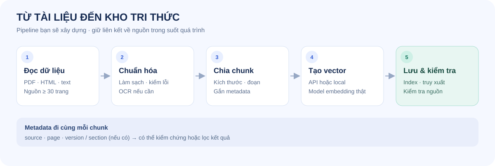
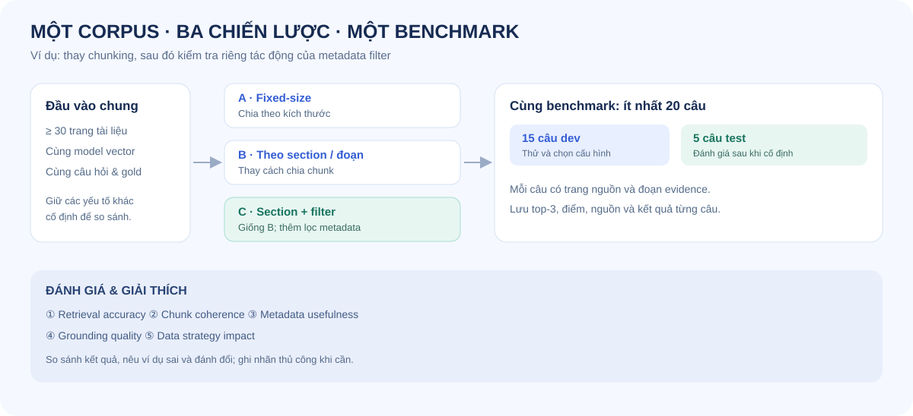

# Day 06 · Data Ingestion Engineering

> ## Bài làm: Thông tư 91/2026/TT-BTC (hóa đơn điện tử, chứng từ điện tử)
>
> Corpus: 1 văn bản scan, OCR 97 trang, dùng trang 1–32 (32 trang nội dung). Nguồn, quyền và cách đếm trang: [data/manifest.yaml](data/manifest.yaml). Benchmark 20 câu (15 dev / 5 test): [benchmark/](benchmark/README.md). Cấu hình A/B/C và kết quả: [artifacts/experiment_log.csv](artifacts/experiment_log.csv). Phần đề bài gốc nằm bên dưới.
>
> | Thành phần | Lựa chọn |
> |---|---|
> | OCR | Tesseract 5.4 (`vie`, 300 dpi, psm 6), render trang bằng PyMuPDF |
> | Embedding | `sentence-transformers/paraphrase-multilingual-MiniLM-L12-v2`, local, 384 chiều, chuẩn hóa L2, chi phí 0 |
> | Vector store | PostgreSQL 16 + pgvector 0.8.7 (Docker), cosine, exact search, bảng `chunks` khóa `(strategy, chunk_id)` |
> | A / B / C | cố định 360/36 · theo Điều/đoạn tối đa 360 · B + filter `chapter` cho câu có filter |
>
> ### Setup (Windows PowerShell, từ thư mục `starter/`)
>
> ```powershell
> python -m venv .venv; .venv\Scripts\Activate.ps1
> python -m pip install -r requirements.txt
> python -m pip install torch --index-url https://download.pytorch.org/whl/cpu
> python -m pip install sentence-transformers
> Copy-Item .env.example .env
> docker compose -p day6_student_starter up -d --wait
> python scripts/check_setup.py
> ```
>
> Cài Tesseract 5.x cho Windows (bản UB Mannheim) ở `C:\Program Files\Tesseract-OCR`, hoặc đặt biến `TESSERACT_CMD`. Tải `vie.traineddata` và `eng.traineddata` từ [tesseract-ocr/tessdata](https://github.com/tesseract-ocr/tessdata) vào `starter/tessdata/` (thư mục này bị gitignore).
>
> ### Chạy lại toàn bộ (từ `starter/`)
>
> ```powershell
> python -m src.ingestion --selftest; python -m src.chunking --selftest; python -m src.evaluation --selftest
> python -m src.ingestion "..\data\raw\Thông-tư-91-2026-TT-BTC.pdf" TT-91-2026 results\pages_TT-91-2026.jsonl   # OCR, ~4 phút
> python -m src.evaluation --verify ..\benchmark\questions.jsonl results\pages_TT-91-2026.jsonl                  # evidence nằm đúng trang
> python -m src.chunking results\pages_TT-91-2026.jsonl 1-32                                                    # thống kê chunk A/B
> python -m src.run ingest            # embed + upsert A, B vào pgvector; chạy 2 lần để kiểm tra không nhân đôi
> python -m src.run benchmark dev     # A, B, C trên 15 câu dev
> python -m src.run benchmark test    # chỉ chạy sau khi đã chọn chiến lược trên dev
> python -m src.run audit             # sinh file chấm thủ công (từ chối ghi đè khi đã có nhãn)
> ```
>
> ### Kết quả (trong `starter/results/`)
>
> | File | Nội dung |
> |---|---|
> | `pages_TT-91-2026.jsonl`, `ocr_TT-91-2026.log` | Text OCR từng trang kèm metadata OCR; log thời gian từng trang |
> | `ingest_log.jsonl` | Mỗi lần ingest: số chunk, phân bố độ dài, token, thời gian, số dòng trong DB, chi phí |
> | `traces_dev.jsonl`, `traces_test.jsonl` | Top-3 đầy đủ (text, score, page, chapter, article, nhãn hit) cho mọi câu × A/B/C |
> | `metrics_dev.json`, `metrics_test.json`, `selection.json` | Hit@1, Evidence Hit@3, tuân thủ filter (n/N); chiến lược chọn trên dev trước khi chạy test |
> | `audit/` | Nhãn thủ công coherence, metadata, grounding + `audit_summary.json` |
>
> Lỗi backend (thiếu Tesseract, thiếu `vie.traineddata`, DB không kết nối được, sai số chiều vector) đều dừng chương trình với thông báo rõ; không có fallback sang vector giả. Kết quả có thể lệch nhẹ nếu dùng phiên bản thư viện khác (đã dùng: sentence-transformers 6.3.0, torch 2.15.0+cpu, PyMuPDF 2.1, pypdf 6.21.4, psycopg 3.3.8, Python 3.13).

**Lab cá nhân** · **4 giờ** · **Dữ liệu tự chọn**

Biến tài liệu thành kho tri thức có thể truy xuất cho AI agent, rồi đo xem cách chuẩn bị dữ liệu nào hiệu quả nhất.

| 📄 Dữ liệu | 🧩 Chiến lược | 🎯 Benchmark |
|---|---|---|
| Tối thiểu **30 trang nội dung** | Tối thiểu **3 cấu hình** | Tối thiểu **20 câu hỏi** |

## Bắt đầu nhanh

Dùng [starter PostgreSQL + pgvector](starter/README.md) để dựng database và hoàn thiện các hàm TODO, hoặc tự chọn vector store tương đương. Starter chỉ là khung: **bạn tự hiện thực pipeline và benchmark**.

## 1. Xây pipeline



Chọn tài liệu được phép sử dụng; giữ **ID tài liệu, nguồn, trang/vị trí** và metadata phù hợp. Dùng embedding model thật qua API hoặc chạy local; lưu và truy xuất bằng pgvector, Qdrant, Chroma hoặc một store tương đương.

## 2. So sánh và đánh giá



Dùng cùng dữ liệu, model và câu hỏi cho cả ba cấu hình. Tách **15 câu dev / 5 câu test** trước khi chạy; chọn cấu hình trên dev, rồi đánh giá test sau khi cố định. Mỗi câu hỏi cần có đoạn bằng chứng và trang nguồn; thiết kế bộ câu hỏi và đánh giá theo [BENCHMARK.md](BENCHMARK.md).

Đánh giá theo năm khía cạnh: **độ chính xác truy xuất**, **tính mạch lạc của chunk**, **tính hữu dụng của metadata**, **chất lượng grounding** và **tác động của chiến lược dữ liệu**. Giải thích lựa chọn bằng kết quả, ví dụ lỗi và các đánh đổi.

## 3. Chuẩn bị bài nộp

1. Chạy pipeline và lưu cấu hình, kết quả top-3, trace cùng nhãn đánh giá thủ công.
2. Điền [thông tin học viên](STUDENT.md), [nhật ký thí nghiệm](artifacts/experiment_log.csv) và bản sao [mẫu báo cáo cá nhân](report/individual/MSSV_HoTen.md).
3. Kiểm tra mã nguồn, cách chạy, manifest dữ liệu và checklist trong [SUBMISSION.md](SUBMISSION.md).

## Tài liệu hướng dẫn

| Bạn cần tìm | Tài liệu |
|---|---|
| Setup baseline PostgreSQL + pgvector | [starter/README.md](starter/README.md) |
| Các bước làm và cách tính chỉ số | [GUIDE.md](GUIDE.md) |
| Tiến độ trong 4 giờ | [CHECKPOINTS.md](CHECKPOINTS.md) |
| Năm tiêu chí benchmark và bộ câu hỏi | [BENCHMARK.md](BENCHMARK.md) |
| Tiêu chí chấm điểm | [RUBRIC.md](RUBRIC.md) |
| Quy tắc sử dụng dữ liệu, AI và API | [RULES.md](RULES.md) |
| Cách nộp bài | [SUBMISSION.md](SUBMISSION.md) |

[data/format-example.json](data/format-example.json) chỉ minh họa định dạng, không phải corpus đủ điều kiện. Phần xử lý và benchmark do bạn tự hiện thực; không bắt buộc xây chatbot.
